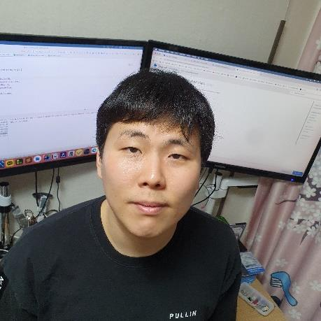

# 김현준 | Java · Spring 백엔드 개발자

**운영 문제를 찾아, 서비스 구조와 업무 흐름을 개선합니다.**

Java·Spring을 주력으로 서비스 개발·데이터 이관·운영 개선을 담당했습니다. 현재는 서비스 개발·유지보수를 단독으로 담당하며, 운영 문제를 개선 과제로 제안하고 경영진과 우선순위를 협의합니다. Android·Python·Flutter로 필요한 기능을 구현한 경험이 있으며, 최근 개인 개발에서는 Codex의 문서·구현·테스트 결과를 직접 검토합니다.

[이메일 · dev.kku@gmail.com](mailto:dev.kku@gmail.com) · [GitHub · dev-kku](https://github.com/dev-kku)

[웹 이력서](https://dev-kku.github.io/dev-kku/) · [경력기술서](resume.md) · [PDF · 5쪽](https://dev-kku.github.io/dev-kku/resume.pdf)

 

## 대표 경험

- **기존 업무 로직을 정리하고 Java로 이관 — 센드페이**  
  게임 포인트 시스템에서 남은 게임 전용 검증 등 현 서비스와 무관한 로직을 제거하고, 프로시저를 Java로 단계적으로 이관했습니다. 정산 데이터로 결과를 확인하고, 오류 시 저장 취소·실패 응답과 로그 분석이 가능하도록 처리했습니다.
- **기존 데이터 이관부터 관리자 업무 자동화까지 — 한빛글로벌**  
  재구축에서 Docker 서버·DB 설계와 회원·거래·잔액 이관을 담당했습니다. 기존 데이터와 이관 결과를 대조하고, 이후 조합원 관리·포인트 지급 서비스를 직접 구축했습니다.
- **Codex로 반복 오류 개선과 검증 범위 관리 — 최근 개인 개발**  
  Flutter 앱의 반복되는 BGM 무음 개선을 요청하고, 회귀 테스트·macOS 실행 및 빌드 결과와 모바일 실기기 미검증 범위를 구분해 기록했습니다. 반복 이미지 오류는 검사 규칙을 AGENTS.md에 남기도록 했습니다.

## 기술 경험

| 기술 | 실제 사용 맥락 |
|---|---|
| **Java · Spring Boot · Spring MVC** | 주력 백엔드. 업무 서비스 개발, 프로시저 로직 이관, 관리자 서비스 구축 |
| **Docker · DB 설계 · SQL** | 업무 서비스의 서버 구축·데이터 구조 설계·이관, 고객사 요청 데이터 조회 |
| **Android · Python** | 블록체인 코어 연동 네이티브 지갑과 연동 서버 개발 |
| **Flutter · Netty** | 개인 채팅 앱의 화면·채팅 통신, 다중 채팅방과 전체·방별 알림 구현 |
| **MySQL · MongoDB · Redis** | 개인 채팅 앱에서 회원 정보·채팅 데이터·캐시로 역할을 나누어 사용 |
| **Codex · Git** | 최근 개인 개발의 문서화·구현·검증 검토, 변경 이력 관리 |

[전체 경력 · 프로젝트 · AI 활용 방식 보기 →](resume.md)
