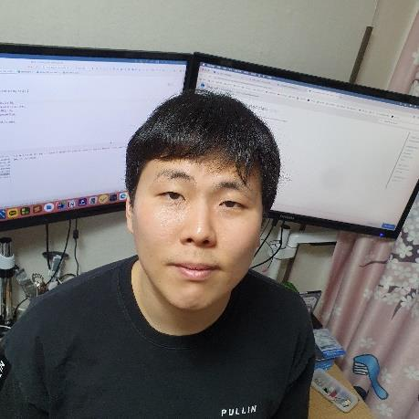

# 김현준

**Java · Spring** 
**백엔드 개발자**

[이메일](mailto:dev.kku@gmail.com) · [GitHub](https://github.com/dev-kku)

 

**비즈니스를 이해하고, 소통을 설계와 구현으로 연결합니다.**

비즈니스를 이해하고, 소통을 설계와 구현으로 연결하는 개발자입니다. 기획자·업무 담당자와 요구의 배경을 짚고, 복잡한 업무 흐름을 코드와 데이터 구조로 풀어냅니다. Java·Spring을 중심으로 서비스 재구축과 데이터 이관, 반복 업무 자동화를 맡아왔습니다. 함께 방향을 찾고 끝까지 구현해, 믿고 일을 맡길 수 있는 개발자를 지향합니다.

[웹 이력서](https://dev-kku.github.io/dev-kku/) · [이력서 2쪽](https://dev-kku.github.io/dev-kku/resume-short.pdf) · [경력기술서 2쪽](https://dev-kku.github.io/dev-kku/career.pdf) · [합본 4쪽](https://dev-kku.github.io/dev-kku/resume.pdf)

## 대표 경험

### 프로시저 중심의 업무 로직을 Java로 이관

**센드페이 · 운영 개선** 
현재 서비스와 무관한 게임 전용 로직을 제거하고 프로시저를 단계적으로 이관했습니다. 정산 데이터로 결과를 검증하고, 오류 시 저장 취소·실패 응답과 로그 분석이 가능하도록 개선했습니다.

### 데이터 이관부터 관리자 업무 자동화까지

**한빛글로벌 · 서버·DB·서비스 개발** 
재구축에서 Docker 서버·DB 설계와 회원·거래·잔액 이관을 맡았습니다. 기존 데이터와 이관 결과를 대조하고, 이후 조합원 관리·포인트 지급 서비스를 직접 구축했습니다.

### 담당자의 업무에 맞춘 쇼핑몰 개선과 업종 전환

**퍼니줌 → 키즈마켓 · 관리자 기능과 서비스 전환** 
외주 쇼핑몰 소스를 인수하고 운영·정산 담당자와 필요한 기능을 정리했습니다. 상품 등록 항목과 공통 카테고리를 다듬고, 후속 프로젝트에서는 같은 기반을 유아동복 서비스로 전환했습니다.

### AI의 문서·구현·테스트 결과를 검토하고 반복 개선

**최근 개인 개발 · Codex 활용** 
요구사항과 작업 기준을 먼저 문서화하고 검토한 뒤 구현·테스트를 진행합니다. 오류가 문서의 정의 문제인지 코드 문제인지 구분해 수정을 요청하고, 반복 오류는 AGENTS.md에 반영합니다. 실행·테스트 결과와 미검증 범위를 구분해 출시 여부를 판단합니다.

[경력별 담당 범위와 기술적 판단 자세히 보기 →](resume.md)

## 최근 개발 기록

[JWT·Redis 세션 검증과 QueryDSL 페이지 조회 개선](https://github.com/dev-kku/dev-kku/blob/main/development-notes/README.md) — 개인 프로젝트 코드와 테스트를 대조한 기술 회고입니다.

## 기술 경험

| 구분 | 기술과 사용 경험 |
|---|---|
| **주력 백엔드** | Java · Spring Boot · Spring MVC — 업무 서비스 개발, 프로시저 이관, 관리자 서비스 구축 |
| **데이터·서버** | Docker · DB 설계 · SQL — 서버 구축, 데이터 구조 설계·이관, 업무 데이터 조회 |
| **실무 기술 확장** | 한빛글로벌 JPA·QueryDSL · 센드페이 Netty 및 Oracle·jQuery 기반 서비스 |
| **개인 채팅 앱** | Flutter · Spring Boot · Netty — 다중 채팅방, 지도에서 조회·참여, 전체·방별 알림 구현 |
| **데이터 저장소** | 개인 채팅 앱의 MySQL(회원 정보) · MongoDB(채팅 데이터) · Redis(캐시 등) |
| **다른 언어 활용** | Android · Python — 블록체인 코어 연동 네이티브 지갑과 연동 서버 개발 |
| **AI 개발 도구** | Codex · Git — 최근 개인 개발의 문서화·구현·검증 검토와 변경 이력 관리 |

---

[전체 경력기술서](resume.md) · [AI 활용 사례](https://dev-kku.github.io/dev-kku/#ai-workflow) · [PDF 내려받기](https://dev-kku.github.io/dev-kku/resume.pdf)
